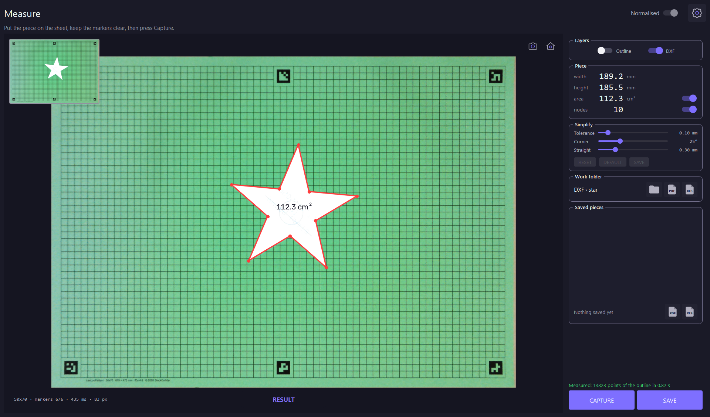

# LeeLooPattern

Paper sewing pattern → DXF by camera.

Put a paper pattern piece on a printed sheet under a camera, press **Capture**, get a closed outline in millimetres as DXF, ready for CAD.



## How it works

- A USB camera looks down at a printed sheet: 10 mm grid, ArUco markers at the edges (`sheets/`).
- The markers tell the sheet format, its border and orientation. All markers must be visible, or the program says which are missing.
- At every start the program calibrates by the grid nodes (about 2400 on the 50×70 sheet): a coarse model by the markers plus a smooth correction field by the real nodes. Lens distortion and tilt are removed.
- Capture takes 15 frames, uses the median, finds the outline of the piece and converts it to sheet millimetres.
- The outline is simplified (straight sides become one segment, corners are the crossing of the sides) and written to DXF.

Test piece: a paper star cut from a DXF. Reference area 112.26 cm², measured 112.2–112.5 cm²; 95 % of the outline points within 0.11–0.36 mm; 10 nodes, the same as the reference.

## Run

Windows, Python 3.14 (not the Microsoft Store one: it has no access to the camera API).

```
py -3.14 -m venv .venv-cam
.venv-cam\Scripts\python -m pip install --only-binary=:all: -r requirements.txt
.venv-cam\Scripts\python leeloopattern.py
```

Without a camera: `leeloopattern.py --sample <folder>` with frames saved by `tools/grab_frames.py`.
Check an installation: `leeloopattern.py --selftest`.

Print a sheet from `sheets/` at 100 % scale and check it once with a ruler. `tools/make_grid_pdf.py` makes other sizes.
Installer: `installer/build.ps1` (PyInstaller + Inno Setup 6).

## Notes

- Code comments cite an internal decision log (`docs/DECISIONS.md`) and reference tests that are not published.
- UI texts are in English; the look follows the LeeLoo palette (MudBlazor colours).

## Story

How this was built — forty years of experience, and Claude writing the code: *link to the dev.to article*.

## License

MIT © 2026 StackCollider
